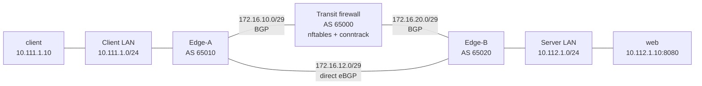

# Routing Path Lab

A self-contained, local graduate-level experiment in BGP path selection, stateful
firewalling, asymmetric flows, and convergence. It uses five Docker containers:
two endpoint hosts, two BGP edge routers, and one BGP-speaking nftables firewall.
It performs no cloud provisioning and probes only the lab's private addresses.

> **Status:** the complete scenario sequence has been run on Docker Desktop
> (Docker Engine 29.9.2, Compose 5.6.1). Measured in this environment:
> baseline HTTP 200 via transit, asymmetric HTTP timeout with an increasing
> firewall drop counter, failover HTTP 200 via the direct link, and restored
> HTTP 200 via transit. These are local observations, not universal claims.
> The asymmetric timeout is caused by this lab's strict stateful/default-drop
> policy: it sees the SYN but not the direct SYN/ACK, so later client packets
> do not match established state. Asymmetry by itself does not guarantee a
> timeout; a different policy could allow it.

## Start here

Prerequisites: Docker Engine/Desktop with Compose v2, permission to build and
start containers, and Python 3.10+ on the host. FRR routers receive the
`NET_ADMIN`, `NET_RAW`, and `SYS_ADMIN` capabilities required by Debian's FRR
daemon privilege setup; endpoint containers receive only `NET_ADMIN` and
`NET_RAW`. No container runs with `--privileged`, publishes a port, or uses the
host network namespace. On Linux, do not run unfamiliar container workloads
with elevated capabilities outside this isolated lab. The lab has no external
network-facing services. macOS/Windows users need a Docker Desktop VM capable
of running Linux containers and multi-network containers. Keep Docker Desktop
resource use modest; no elevated host networking or `--privileged` mode is used.

```sh
docker compose config
docker compose up --build -d
docker compose ps
python3 app/labctl.py scenario baseline
```

If the baseline assertion passes, continue with
[the hands-on curriculum](docs/LAB_GUIDE.md). To stop and remove containers and
networks, run `docker compose down`; `docker compose down --rmi local` also
removes this lab's locally built images.

## What you will build and demonstrate

The starter topology has deterministic interface names and IPs. The two edge
routers originate the endpoint prefixes; the firewall is an eBGP transit AS and
forwards only client-initiated HTTP (TCP/8080) and ICMP between the lab LANs.
Baseline local preference makes both directions use the firewall. Raising
Edge-B's direct-path preference changes only its return route. A separate link
failure withdraws one BGP adjacency and allows the direct route to take over.



`edge-a`, `transit-fw`, and `edge-b` have Linux forwarding enabled. Endpoint
routes are explicit. Reverse-path filtering is disabled only inside the router
containers because asymmetric paths can otherwise be rejected by the Linux
kernel before the experiment reaches the firewall policy.
The source topology's client/server subnets collided with two pre-existing
Docker networks on this host, so this lab uses `10.111.1.0/24` and
`10.112.1.0/24` instead. The point-to-point links use `/29` so Docker can
reserve each bridge's `.1` gateway; router endpoints use `.2`/`.3`.

| Node | Autonomous system | Interfaces (`interface: address`) |
|---|---:|---|
| client | — | `eth1: 10.111.1.10/24` |
| edge-a | 65010 | `eth1: 10.111.1.2`, `eth2: 172.16.10.2`, `eth3: 172.16.12.2` |
| transit-fw | 65000 | `eth1: 172.16.10.3`, `eth2: 172.16.20.3` |
| edge-b | 65020 | `eth1: 10.112.1.2`, `eth2: 172.16.20.2`, `eth3: 172.16.12.3` |
| web | — | `eth1: 10.112.1.10/24`, HTTP `:8080` |

## Scenario commands

Run each from the project root. `labctl` checks the selected Linux forwarding
interface—not merely that a route exists—and waits for convergence before
declaring a route expectation satisfied.

```sh
python3 app/labctl.py status
python3 app/labctl.py probe
python3 app/labctl.py scenario baseline
python3 app/labctl.py scenario asymmetric
python3 app/labctl.py scenario failover
python3 app/labctl.py scenario restore
```

The baseline expects Edge-A to send server traffic on `eth2` and Edge-B to send
client traffic on `eth2`; both directions cross the firewall. The asymmetric
experiment expects Edge-A to stay on `eth2` while Edge-B selects direct `eth3`.
Under the lab's stateful default-drop policy, the asymmetric experiment expects
an HTTP timeout: the firewall sees the initial SYN, but the SYN/ACK returns
direct and the later client ACK/data packets are dropped as they fail to match
established connection state. The runner asserts a rising nftables drop
counter. This timeout is specific to this policy; asymmetry itself does not
always break TCP. The failover experiment expects both edge routers to select
`eth3` after Edge-A's transit interface is brought down and HTTP to recover
over that direct link, which bypasses the firewall.

### Measured run (2026-10-24, Docker Desktop on aarch64)

These are actual outputs from the scenario runner in this project environment,
not predictions. Runtime: Docker Engine 29.9.2, Compose 5.6.1, FRRouting
8.4.4 on Linux 7.0.14-linuxkit.

| Scenario | Edge-A route to server | Edge-B route to client | Measured HTTP / firewall evidence |
|---|---|---|---|
| Baseline | `eth2` (firewall) | `eth2` (firewall) | HTTP 200 |
| Asymmetric | `eth2` (firewall) | `eth3` (direct) | HTTP timeout; forward-chain drop counter increased by 9 packets |
| Transit failure | `eth3` (direct) | `eth3` (direct) | HTTP 200; direct bypass |
| Restored | `eth2` (firewall) | `eth2` (firewall) | HTTP 200 |

The asymmetric timeout follows from the specific forward-chain policy and
forward/return path observed in this implementation. Re-run the scenarios on
your platform and record any difference; do not generalize this result to
other stateful-firewall policies or real cloud networks.

For exact predictions, evidence commands, packet capture, and explanations, see
[`docs/LAB_GUIDE.md`](docs/LAB_GUIDE.md). Operational recovery and troubleshooting
are in [`docs/OPERATIONS.md`](docs/OPERATIONS.md). Use
[`evidence/EXPERIMENT-LOG.md`](evidence/EXPERIMENT-LOG.md) to distinguish
measured observations from hypotheses.

## Validation and reproducibility

```sh
docker compose config
python3 -m unittest discover -s tests -v
```

Docker image tags are versioned in the Compose build files. OS packages are
installed from the pinned Debian release's package repositories at build time;
for bit-for-bit rebuilds, pin/snapshot those repositories as part of a
controlled research environment. `docker compose config` validates the model
without starting containers. Runtime behavior is not considered validated
until the learner runs the scenarios and records their evidence.

## Learning outcomes

After completing the labs and capstone, you should be able to explain and
demonstrate L2/L3 adjacency, longest-prefix route lookup, eBGP sessions and
route propagation, LOCAL_PREF versus AS_PATH selection, Linux forwarding,
conntrack state, asymmetric visibility and policy enforcement, BGP withdrawal
and convergence, evidence-driven test design, and the limitations of this
container simulation. The guide includes prerequisites, a staged curriculum,
troubleshooting, glossary, oral-defense prompts, and a scored capstone rubric.
